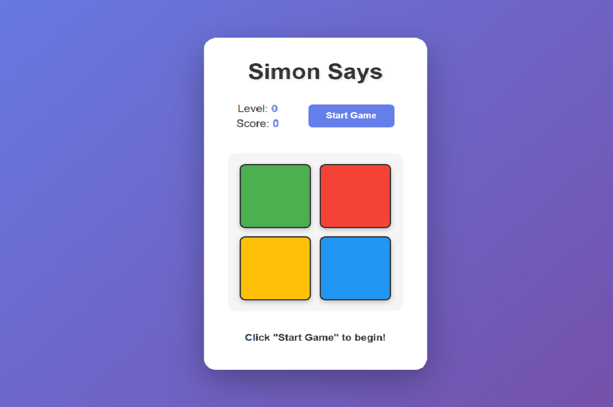

# Simon Says

A classic memory game built for the browser. Watch the pattern of colors light up, then repeat it in the same order. Each round adds one more step, so it gets harder as you go.



## Features

- 4-color game grid with light and sound-style feedback
- Start Game button to begin a round
- Level and score tracking
- Game over when you click the wrong color

## How to Play

1. Click **Start Game**.
2. Watch the sequence of colors flash.
3. Repeat the sequence by clicking the colors in the same order.
4. Each correct round raises your level and score.
5. One wrong click ends the game, so try to beat your best score.

## Tech Stack

- [HTML, CSS, JavaScript — change to match yours]

## Live Demo

[Add your deployed link here]

## Run Locally

```bash
git clone https://github.com/[your-username]/[repo-name].git
cd [repo-name]
# open index.html in your browser
```
